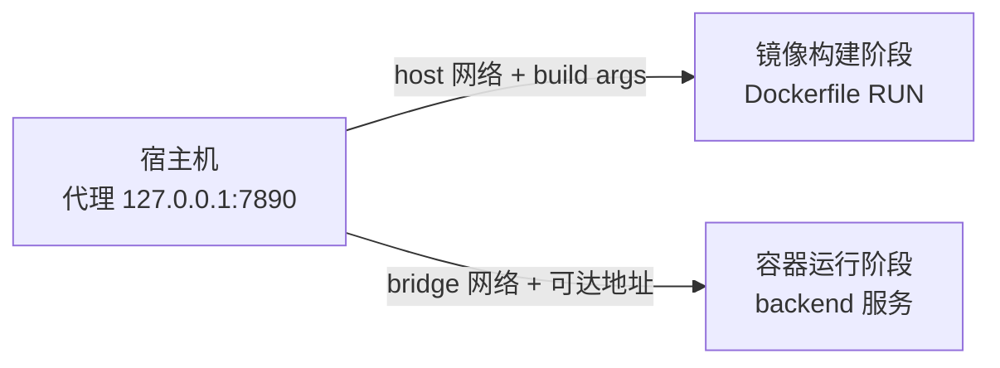

# Docker 网络代理配置：让容器和构建过程使用宿主机代理

最近在 Arch Linux 上启动一个 RAG 项目时，backend 镜像卡在了依赖安装这一步：

```dockerfile
RUN uv sync --frozen --no-install-project --no-dev
```

日志里最先出现的是：

```text
Failed to download `langgraph-checkpoint-postgres==3.2.0`
client error (Connect)
dns error
failed to lookup address information: Try again
```

这个报错很容易让人先去怀疑依赖版本、锁文件，甚至怀疑 `langgraph-checkpoint-postgres` 这个包是不是不存在。实际问题并不在依赖本身，而是 **Docker 的构建过程没有使用宿主机上的网络代理**。

这篇文章记录一下 Docker 代理配置中最容易混淆的几层关系：

- 宿主机的代理端口不会自动传给 Docker；
- 镜像构建阶段和容器运行阶段是两套网络场景；
- `127.0.0.1` 在宿主机、构建容器和普通业务容器中指向的对象不同；
- `network` 和 `build.args` 解决的是两个不同的问题。

## 一、问题背景：代理一直开着，但 Docker 还不知道

我的桌面环境是 Arch Linux + Niri + Wayland。当前系统 session 下，代理端口要么一直开启，要么一直关闭；如果要切换这个状态，通常需要注销后重新登录，不能像切换一个普通环境变量那样随手改变。

为了避免反复注销登录，我选择让网络代理和代理端口持续开启。平时宿主机上的程序都在这个环境中运行，项目本身也没有遇到网络问题。

问题出在 Docker：之前只配置了宿主机的代理，没有意识到 Docker 的构建步骤还需要单独配置代理。于是项目启动时，backend 镜像在执行 `uv sync` 下载依赖的阶段失败了。

这里的重点不是“某个 Python 包下载失败”，而是：**宿主机正在使用代理，不代表 Docker 的构建过程也正在使用代理。**

## 二、先理解 Docker 中的网络边界

### 1. `127.0.0.1` 不总是指向同一台机器

假设宿主机上的代理监听在：

```text
http://127.0.0.1:7890
```

在不同网络环境中，这个地址的含义并不相同：

| 使用位置                       | `127.0.0.1` 指向谁   |
| ------------------------------ | -------------------- |
| 宿主机上的浏览器或终端         | 宿主机自己           |
| 普通 Docker bridge 容器        | 当前容器自己         |
| 使用 host 网络的容器或构建步骤 | 宿主机的网络命名空间 |

所以，在宿主机上执行下面的命令能够成功：

```bash
curl -x http://127.0.0.1:7890 https://pypi.org/simple/
```

并不能推出 Dockerfile 里的这一步也一定能成功：

```dockerfile
RUN uv sync --frozen --no-install-project --no-dev
```

如果构建步骤运行在普通网络中，构建容器里的 `127.0.0.1:7890` 指向的是构建容器本身，不是宿主机上的代理。

### 2. 构建阶段和运行阶段不是一回事

Docker 代理问题至少要拆成两个阶段看：



**构建阶段**通常需要处理：

- `uv`、`pip`、`npm` 等工具下载依赖；
- `docker build` 使用什么网络；
- 构建步骤是否能拿到 `HTTP_PROXY`、`HTTPS_PROXY` 等环境变量。

**运行阶段**通常需要处理：

- backend 是否需要访问 DeepSeek、SiliconFlow 等外部 API；
- 容器使用 bridge 网络时，如何访问宿主机代理；
- 代理服务是否监听了 Docker 网桥可以访问的地址。

这两个阶段可以使用不同配置。只修复构建阶段，不代表运行中的 backend 也能通过代理访问外部服务。

### 3. Docker daemon 的代理也不是构建步骤的代理

Docker daemon 能够通过代理拉取基础镜像，也不代表 Dockerfile 中的 `RUN` 步骤会自动获得相同的代理配置。

可以把它们理解为不同层次：

- Docker daemon 负责和镜像仓库通信；
- Dockerfile 的 `RUN` 步骤由构建容器执行；
- `uv` 是否使用代理，取决于构建步骤能否获得代理变量，以及它所在的网络能否访问代理端口。

因此，不要只看到基础镜像可以正常拉取，就认为构建阶段的依赖下载也已经配置好了。

## 三、先用一个临时容器验证代理

排查时不要直接反复重试完整构建。先启动一个带有 `uv` 的临时容器，分别验证网络和代理是否可用。

### 1. 测试官方 PyPI

在 Linux Docker Engine 上，可以这样测试：

```bash
docker run --rm \
  --network host \
  -e HTTP_PROXY=http://127.0.0.1:7890 \
  -e HTTPS_PROXY=http://127.0.0.1:7890 \
  ghcr.io/astral-sh/uv:python3.12-bookworm-slim \
  sh -lc 'python -c "import urllib.request; print(urllib.request.urlopen(\"https://pypi.org/simple/\", timeout=10).status)"'
```

如果输出：

```text
200
```

说明在 `host` 网络和显式代理变量都存在的情况下，容器可以通过宿主机代理访问 PyPI。

### 2. 测试项目实际使用的镜像

如果项目的 `uv.lock` 中使用的是清华 PyPI 镜像，还应该测试这个实际地址：

```bash
docker run --rm \
  --network host \
  -e HTTP_PROXY=http://127.0.0.1:7890 \
  -e HTTPS_PROXY=http://127.0.0.1:7890 \
  ghcr.io/astral-sh/uv:python3.12-bookworm-slim \
  sh -lc 'python -c "import urllib.request; print(urllib.request.urlopen(\"https://pypi.tuna.tsinghua.edu.cn/simple/langgraph-checkpoint-postgres/\", timeout=10).status)"'
```

同样输出 `200` 后，再继续配置实际项目的构建命令。

如果这里失败，应该继续排查代理端口、代理软件的访问规则和目标镜像，而不是先修改 Python 依赖版本。

## 四、单次构建：配置 host 网络和代理变量

确认临时容器可以访问网络后，可以先用命令行验证完整镜像构建：

```bash
cd cook-rag

docker build \
  --network host \
  --build-arg HTTP_PROXY=http://127.0.0.1:7890 \
  --build-arg HTTPS_PROXY=http://127.0.0.1:7890 \
  --build-arg ALL_PROXY=http://127.0.0.1:7890 \
  -f Dockerfile.backend \
  -t cook-rag-backend:test \
  .
```

这里同时配置了两类参数：

- `--network host`：让构建步骤使用宿主机网络，从而能够访问宿主机上的代理端口；
- `--build-arg`：把代理变量传给构建过程中的工具，例如 `uv`。

如果这条命令可以成功完成，通常说明 Python 依赖、Python 版本和 Dockerfile 本身没有根本问题，之前的失败点集中在 Docker 构建网络或代理配置上。

## 五、在 Docker Compose 中持久化配置

命令行参数适合验证问题，但不适合每次都手动输入。长期使用时，可以把构建网络和代理变量写进 Compose 配置。

### 1. 在 `build` 中配置构建网络

下面这种写法是无效的：

```bash
docker compose build --network host
```

它会报：

```text
unknown flag: --network
```

`--network` 是 `docker build` 的参数，不能直接当作 `docker compose build` 的命令行参数使用。Compose 应该在服务的 `build` 配置中声明：

```yaml
services:
  backend:
    build:
      context: .
      dockerfile: Dockerfile.backend
      network: host
      args:
        HTTP_PROXY: ${HTTP_PROXY:-}
        HTTPS_PROXY: ${HTTPS_PROXY:-}
        ALL_PROXY: ${ALL_PROXY:-}
        NO_PROXY: ${NO_PROXY:-localhost,127.0.0.1,::1,postgres}
```

### 2. 在项目根目录配置 `.env`

Compose 会读取项目根目录的 `.env` 文件。可以配置：

```env
HTTP_PROXY=http://127.0.0.1:7890
HTTPS_PROXY=http://127.0.0.1:7890
ALL_PROXY=http://127.0.0.1:7890
NO_PROXY=localhost,127.0.0.1,::1,postgres
```

`NO_PROXY` 用来声明不需要经过代理的地址。这里保留 `postgres`，是因为 backend 访问同一个 Compose 网络中的 PostgreSQL 服务时，不应该绕到外部代理。

重新构建 backend：

```bash
docker compose build --no-cache backend
```

确认构建成功后，再启动服务：

```bash
make up
```

如果项目中的 `make up` 已经封装了 Compose 的 `up --build`，之后直接执行 `make up` 即可。

### 3. 为什么 `network` 和 `build.args` 都要配置

这两项配置解决的是不同问题：

| 配置                    | 解决的问题                                   |
| ----------------------- | -------------------------------------------- |
| `build.network: host`   | 构建步骤如何连接网络，能否访问宿主机代理端口 |
| `build.args.HTTP_PROXY` | 构建工具是否知道应该使用哪个代理             |

只配置其中一项都可能失败：

- 只有 `build.args`：构建工具知道代理地址，但普通构建网络中的 `127.0.0.1:7890` 仍然指向构建容器自己；
- 只有 `network: host`：构建步骤拥有访问宿主机网络的条件，但 `uv` 未必会自动获得代理变量。

所以，对于当前这种“代理只监听宿主机回环地址”的情况，两项配置应该一起使用。

## 六、运行时代理：容器访问外部 API

上面的配置主要解决 **镜像构建阶段** 的依赖下载。如果 backend 运行后还要通过代理访问 DeepSeek、SiliconFlow 等外部 API，则需要在服务的 `environment` 中再次配置代理变量：

```yaml
services:
  backend:
    environment:
      HTTP_PROXY: ${HTTP_PROXY:-}
      HTTPS_PROXY: ${HTTPS_PROXY:-}
      ALL_PROXY: ${ALL_PROXY:-}
      NO_PROXY: ${NO_PROXY:-localhost,127.0.0.1,::1,postgres}
```

注意，这里的 `environment` 和前面的 `build.args` 不是同一个配置：

- `build.args` 只在镜像构建期间生效；
- `environment` 在容器启动后注入运行时环境。

### 1. bridge 容器不能直接使用宿主机的 `127.0.0.1`

如果 backend 运行在默认 bridge 网络中，容器里的：

```text
http://127.0.0.1:7890
```

仍然指向 backend 容器自己。此时可以为宿主机添加一个容器可解析的名称：

```yaml
services:
  backend:
    extra_hosts:
      - 'host.docker.internal:host-gateway'
```

然后将 `.env` 中的代理地址改成：

```env
HTTP_PROXY=http://host.docker.internal:7890
HTTPS_PROXY=http://host.docker.internal:7890
ALL_PROXY=http://host.docker.internal:7890
```

但这还不是全部。宿主机上的代理软件也必须允许来自 Docker 网桥的连接。

### 2. 检查代理监听地址

可以先查看 `7890` 端口当前监听在哪个地址：

```bash
ss -lntp | grep 7890
```

如果结果类似：

```text
127.0.0.1:7890
```

普通 bridge 容器通常无法访问这个端口。此时需要在代理软件中开启允许局域网访问，或者让代理监听 Docker 网桥可达的地址。

不过，**不要为了让容器能访问，就无条件把代理监听到 `0.0.0.0`**。扩大监听范围时，至少应该同时考虑：

- 防火墙规则；
- 代理认证；
- 只允许 Docker 网桥或可信网段访问；
- 代理软件是否会把端口暴露给整个局域网。

如果只是构建阶段需要访问宿主机代理，优先使用前面介绍的 `host` 网络和 `build.args`，不一定要改变代理软件的监听范围。

## 七、几个容易踩中的误区

### 误区一：宿主机设置了代理，Docker 会自动继承

宿主机上的 shell、浏览器或其他程序使用的代理变量，不会自动变成 Dockerfile 构建步骤中的代理配置。构建时要显式传入 `HTTP_PROXY`、`HTTPS_PROXY` 等变量。

### 误区二：只配置 `HTTP_PROXY` 就够了

依赖下载通常使用 HTTPS 地址，因此只设置 `HTTP_PROXY` 可能仍然不生效。至少应该同时检查：

```text
HTTP_PROXY
HTTPS_PROXY
```

如果使用的工具需要，也可以配置 `ALL_PROXY`。

### 误区三：只设置代理变量，不处理网络可达性

代理变量只是告诉工具“去哪里代理”。如果构建网络中的 `127.0.0.1` 指向错误的网络命名空间，工具即使拿到了正确的变量，也连接不到代理。

### 误区四：只设置 `network: host`，不设置构建参数

host 网络解决的是连接路径问题，不一定会让 `uv` 自动决定使用代理。当前场景下，网络和代理变量都应该显式配置。

### 误区五：把构建代理和运行时代理混为一谈

`build.args` 解决镜像构建期间的问题，`environment` 解决容器运行后的问题。构建成功并不代表运行时访问外部 API 一定成功。

### 误区六：看到第一个失败的包，就认为包不存在

依赖解析或下载过程中的第一个失败包只是错误暴露的位置。像下面这种错误：

```text
dns error
failed to lookup address information
```

更应该优先检查 DNS、网络和代理，而不是立刻修改依赖版本。

## 八、`uv.lock` 中的镜像配置只是补充因素

这个项目的 `uv.lock` 当前还会将依赖下载地址指向清华 PyPI 镜像。也可以在网络条件允许的环境中，使用官方 PyPI 重新生成锁文件：

```bash
uv lock --refresh --default-index https://pypi.org/simple
```

然后检查锁文件和依赖状态：

```bash
grep -n 'pypi.tuna.tsinghua.edu.cn' uv.lock
uv lock --check
```

但更换依赖源不能替代 Docker 代理配置。如果访问官方 PyPI 本身也必须经过代理，那么构建步骤仍然需要正确获得代理变量，并且所在网络必须能够连接代理端口。

所以排查顺序应该是：

1. 先确认目标地址和代理本身可以访问；
2. 再确认 Docker 构建网络可以到达代理；
3. 再确认构建工具拿到了代理变量；
4. 最后再考虑依赖源或锁文件是否需要调整。

## 九、一份可以直接参考的 Compose 配置

如果当前项目只需要在构建阶段使用宿主机代理，可以先配置：

```yaml
services:
  backend:
    build:
      context: .
      dockerfile: Dockerfile.backend
      network: host
      args:
        HTTP_PROXY: ${HTTP_PROXY:-}
        HTTPS_PROXY: ${HTTPS_PROXY:-}
        ALL_PROXY: ${ALL_PROXY:-}
        NO_PROXY: ${NO_PROXY:-localhost,127.0.0.1,::1,postgres}
```

项目根目录的 `.env`：

```env
HTTP_PROXY=http://127.0.0.1:7890
HTTPS_PROXY=http://127.0.0.1:7890
ALL_PROXY=http://127.0.0.1:7890
NO_PROXY=localhost,127.0.0.1,::1,postgres
```

验证配置：

```bash
docker compose build --no-cache backend
make up
```

如果运行中的 backend 也需要访问外部 API，则再补充运行时配置：

```yaml
services:
  backend:
    environment:
      HTTP_PROXY: ${HTTP_PROXY:-}
      HTTPS_PROXY: ${HTTPS_PROXY:-}
      ALL_PROXY: ${ALL_PROXY:-}
      NO_PROXY: ${NO_PROXY:-localhost,127.0.0.1,::1,postgres}
    extra_hosts:
      - 'host.docker.internal:host-gateway'
```

这时还需要确保代理软件监听在 Docker 容器可以访问的地址，并把 `.env` 中的代理主机改为 `host.docker.internal`。

## 十、总结

这次问题的根因是 Docker 没有使用宿主机已经开启的网络代理。

记住下面几条，基本就能避开大多数类似问题：

- 宿主机的代理不会自动传递给 Docker；
- 普通容器中的 `127.0.0.1` 指向容器自己；
- 构建阶段使用 `build.network` 和 `build.args`；
- 运行阶段使用 `environment`，bridge 网络下还要处理宿主机代理地址；
- `network` 解决网络路径，代理变量解决工具配置，两者不是一回事；
- 不要为了让容器访问代理而无条件暴露 `0.0.0.0`；
- 看到 DNS 或连接错误时，先查网络和代理，再怀疑依赖包。

对我这个场景来说，最终的关键配置就是：**让 Docker backend 构建使用 host 网络，并显式传入宿主机 `7890` 端口上的代理。**

另外，npm 等其他也同理。
